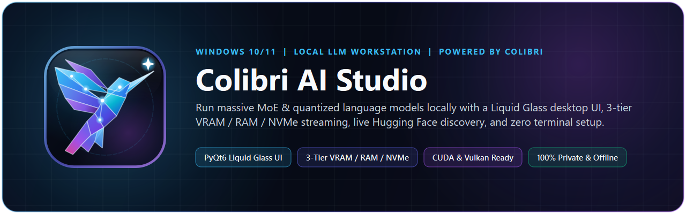
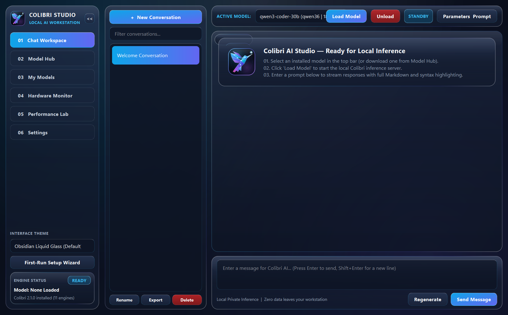
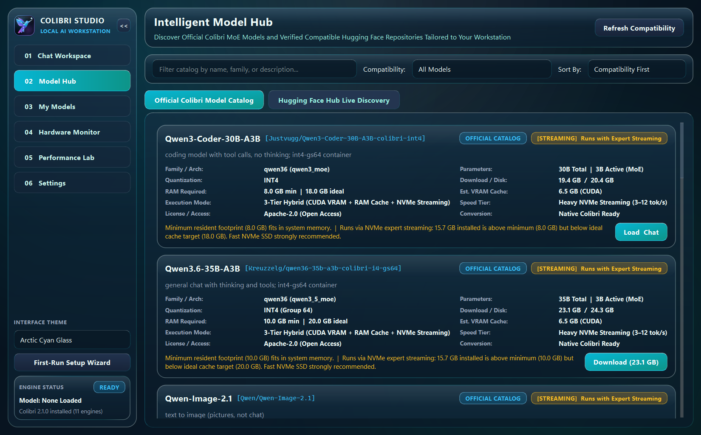
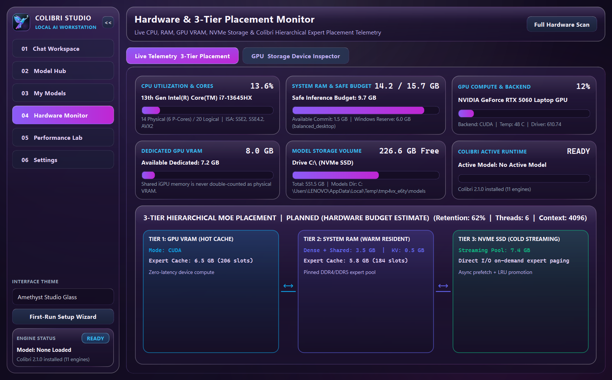
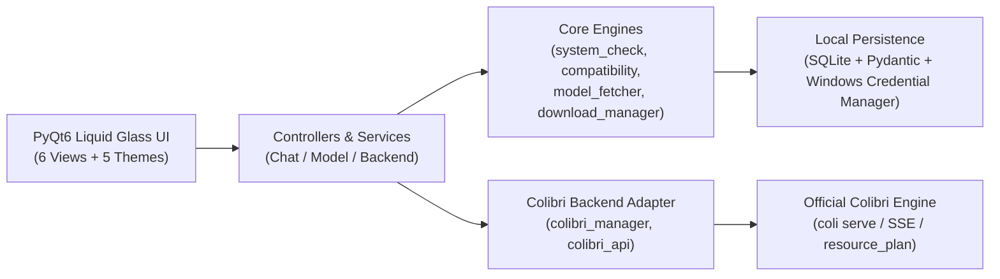

<div align="center">



# Colibri AI Studio — Local AI Workstation & LLM Desktop Client for Windows

**Run massive Mixture-of-Experts (MoE) and quantized GGUF large language models locally on Windows 10/11 with a Liquid Glass desktop interface, automatic hardware profiling, 3-tier VRAM / RAM / NVMe streaming, and zero terminal setup.**

[](https://www.python.org/)
[](https://riverbankcomputing.com/software/pyqt/)
[](https://www.microsoft.com/windows)
[](https://github.com/JustVugg/colibri)
[](LICENSE)

[Key Features](#key-features) • [Visual Showcase](#visual-showcase) • [How 3-Tier Streaming Works](#how-3-tier-vram--ram--nvme-streaming-works) • [Quick Start](#quick-start) • [Architecture](#architecture) • [Build Executable](#building-testing--packaging)

</div>

---

## Overview

**Colibri AI Studio** is a production-grade Windows desktop workstation built around the open-source [Colibri inference engine](https://github.com/JustVugg/colibri). While traditional local LLM tools fail with Out-of-Memory errors when a 30B–744B parameter model exceeds your GPU VRAM, Colibri AI Studio uses **3-tier hierarchical expert placement** across **GPU VRAM, System RAM, and NVMe SSD storage** — paired with a ChatGPT-style Liquid Glass interface so both nontechnical users and AI engineers can discover, download, benchmark, and chat with massive local AI models completely offline.

### Why Colibri AI Studio?
- **No Terminal Required:** Automatic first-run hardware profiling, engine provisioning, model compatibility scoring, and one-click local server startup.
- **100% Private & Local:** All inference runs on `127.0.0.1` via Colibri's OpenAI-compatible SSE server (`coli serve`). Zero telemetry or prompts leave your PC.
- **Hardware-Aware Compatibility:** Uses Colibri's native planner (`resource_plan.py` & `setup_hw.py`) alongside NVML, Vulkan, and Windows DXGI/WMI APIs so you know *before* downloading whether a model runs natively or via NVMe expert streaming.

---

## Visual Showcase

### 1. Liquid Glass Chat Workspace (Obsidian Liquid Glass)
Real-time Server-Sent Events (`POST /v1/chat/completions`) streaming with collapsible `<think>` / `reasoning_content` reasoning traces, Pygments syntax highlighting, XSS-safe Markdown rendering, and per-message `tok/s` & Time-to-First-Token (`TTFT`) telemetry.



### 2. Intelligent Model Hub & Live Hugging Face Discovery (Arctic Cyan Glass)
Combines the official Colibri MoE catalog (`setup_catalog.py`) with live Hugging Face Hub API discovery, strict `config.json` `model_type` architecture verification, and **Green / Yellow / Red** hardware compatibility badges.



### 3. Hardware Monitor & 3-Tier MoE Placement Visualizer (Amethyst Studio Glass)
Live CPU ISA (`AVX2`, `AVX-512`, `AVX-VNNI`), RAM safety budget, dedicated GPU VRAM (without double-counting integrated GPU shared memory), NVMe drive telemetry, and real-time 3-tier memory placement visualization.



---

## Key Features

- **5 Built-In Liquid Glass Themes:** Multi-layered translucent frosted glass panels, Windows 11 DWM Acrylic/Mica integration, and specular rim lighting across every screen, dialog, and tab:
  1. `Obsidian Liquid Glass` (Default Dark)
  2. `Arctic Cyan Glass`
  3. `Amethyst Studio Glass`
  4. `Emerald Workstation Glass`
  5. `Alabaster Frosted Daylight` (Light)
- **Refined Workstation Typography:** OpenType/ClearType antialiased `Segoe UI Variable Text` / `Inter` / `Aptos` UI typography paired with `Cascadia Code` / `JetBrains Mono` monospace telemetry and code blocks, with zero distracting emojis.
- **Smart First-Launch Setup Wizard:** Profiles CPU cores/ISA, Windows commit-aware RAM, CUDA/Vulkan GPUs, and NVMe volumes; provisions official Colibri Windows binaries into `%LOCALAPPDATA%\ColibriAIStudio\engine`; and recommends a compatible starter model.
- **Workload-Aware Memory Profiles:** Switch between *AI Dedicated*, *Balanced Desktop*, *Engineering Workstation* (reserves headroom for CAD/Blender/Unity), and *Custom* RAM/VRAM reserves.
- **Resumable Download & Local GGUF Importer:** HTTP Range `.part` resume, `.colibri-download.json` manifests, real-time MB/s & ETA tracking, SHA-256 integrity checks, and one-click local `.gguf` conversion via `coli import`.
- **Performance Lab:** Wraps `coli tune` (`autotune.py`), bounded 64 MB sequential NVMe read speed benchmarking, and persistent SQLite benchmark history.
- **Self-Contained Frozen Windows Executable:** Bundles an embedded Python helper runner (`--colibri-python-helper` and `-c`) so Colibri's pure-Python control plane runs inside `ColibriAIStudio.exe` without requiring a system-wide Python installation.

---

## How 3-Tier VRAM / RAM / NVMe Streaming Works

Colibri AI Studio visualizes and configures Colibri's 3-tier Mixture-of-Experts memory hierarchy:

| Tier | Storage Medium | Role in Inference |
|---|---|---|
| **Tier 1 (Hot Cache)** | **GPU VRAM** (CUDA / Vulkan) | Zero-latency compute for dense layers and hottest MoE experts |
| **Tier 2 (Warm Resident)** | **System RAM** (DDR4 / DDR5) | Pinned expert cache & KV cache bounded by your Windows safety reserve |
| **Tier 3 (Cold Streaming)** | **NVMe / SSD Storage** | On-demand async expert paging with LRU promotion for massive models |

---

## Architecture



<details>
<summary><strong>Project Directory Structure</strong></summary>

```text
ColibriAIStudio/
├── main.py                      # GUI entry point + embedded Colibri Python helper
├── pyproject.toml               # Project metadata & pytest configuration
├── requirements.txt             # Production dependencies
├── requirements-dev.txt         # Development, testing & PyInstaller dependencies
├── app/
│   ├── bootstrap.py             # QApplication, AppUserModelID, icon & startup
│   ├── application_state.py     # Shared state, repositories & Qt signals
│   ├── core/                    # Hardware profiler, compatibility, downloads, Colibri adapter
│   ├── models/                  # Pydantic hardware, model, download & settings schemas
│   ├── database/                # SQLite schema, migrations & CRUD repositories
│   ├── services/                # Settings, installation, registry, conversations, diagnostics
│   ├── controllers/             # Non-blocking QThread orchestration controllers
│   ├── ui/                      # Liquid Glass engine, QSS themes, MainWindow, widgets & views
│   └── utils/                   # Path resolution, redacted logging, Windows Shell shortcuts
├── assets/
│   ├── colibri_runtime/         # Bundled Colibri control-plane scripts & registries
│   ├── graphics/                # Hero banner & live UI showcase screenshots
│   └── icons/                   # Vector SVG, 512px PNG & multi-res Windows .ico
├── scripts/
│   ├── build_deploy.py          # Full test -> PyInstaller -> smoke-test -> Desktop shortcut pipeline
│   ├── capture_readme_graphics.py # Automated hero banner & UI screenshot generator
│   ├── generate_logo.py         # Vector-to-PNG/ICO brand asset generator
│   └── verify_build.py          # Packaged .exe & shortcut verification
└── tests/                       # 26 automated unit & pytest-qt GUI tests
```

</details>

---

## Quick Start

### Option A — Launch the Packaged Windows Executable
1. Download the latest `ColibriAIStudio.exe` release (or build it with `scripts\build.bat`), then launch it or double-click the **`Colibri AI Studio`** desktop shortcut.
2. Complete the 3-step **First-Run Setup Wizard** to install the prebuilt Colibri Windows engine binaries (`colibri.exe`, `qwen36.exe`, Vulkan shaders) into `%LOCALAPPDATA%\ColibriAIStudio\engine` and queue a compatible model.

### Option B — Run from Source (Windows 10/11, Python 3.11+)
```powershell
git clone https://github.com/scientist444/colibri-ai-studio.git
cd colibri-ai-studio
python -m venv .venv
.\.venv\Scripts\Activate.ps1
pip install -r requirements-dev.txt
python main.py
```
Or launch directly using the helper script:
```powershell
.\scripts\run_dev.bat
```

---

## Building, Testing & Packaging

Run the full automated verification and Windows packaging pipeline (26 `pytest` + `pytest-qt` tests → PyInstaller `--onefile --windowed` build → embedded helper test → GUI smoke test → Windows Desktop `.lnk` shortcut):

```powershell
.\scripts\build.bat
```

Or run steps individually:
```powershell
pytest tests -v
python scripts\build_deploy.py
python scripts\verify_build.py
```

---

## Data & Privacy Storage Locations

All mutable data is stored outside the executable under `%LOCALAPPDATA%\ColibriAIStudio`:
- **Settings:** `%LOCALAPPDATA%\ColibriAIStudio\settings.json`
- **SQLite Database:** `%LOCALAPPDATA%\ColibriAIStudio\colibri_studio.db`
- **Colibri Engine Runtime:** `%LOCALAPPDATA%\ColibriAIStudio\engine`
- **Default Model Weights:** `%LOCALAPPDATA%\ColibriAIStudio\models` (configurable to any fast NVMe/SSD drive)
- **Rotating Logs:** `%LOCALAPPDATA%\ColibriAIStudio\logs\colibri_studio.log` (with automatic token/secret redaction)
- **Credentials:** Encrypted in **Windows Credential Manager** via `keyring` (`ColibriAIStudio`).

---

## Troubleshooting

- **Model Server Port Busy (`127.0.0.1:8000`):** Open **Settings → 04. Inference** and change the port (e.g., `8001`).
- **Gated Hugging Face Models (HTTP 401/403):** Accept the model's license on `huggingface.co`, then save your Hugging Face Read Token in **Settings → 05. Privacy & Security**.
- **Native Engine Binaries Missing:** Open **Settings → 06. Diagnostics** (or click **First-Run Setup Wizard** in the sidebar) and click **Install / Repair Colibri Engine**.

---

## License & Attributions

Licensed under the **Apache License 2.0** — see [LICENSE](LICENSE) and [LICENSE-NOTICES.md](LICENSE-NOTICES.md). Powered by the open-source [Colibri inference engine](https://github.com/JustVugg/colibri).
